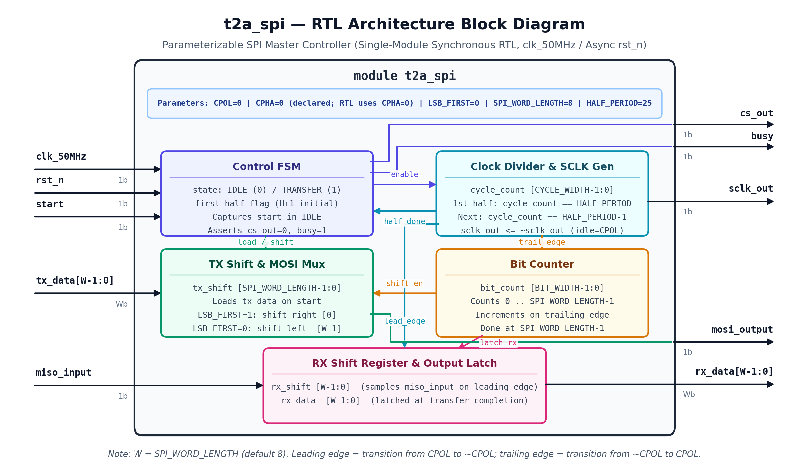
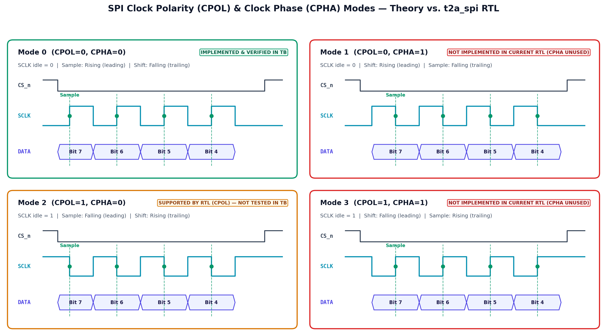
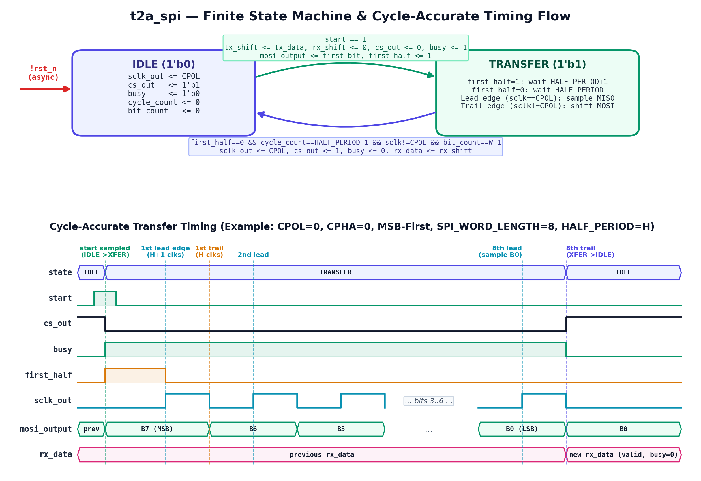
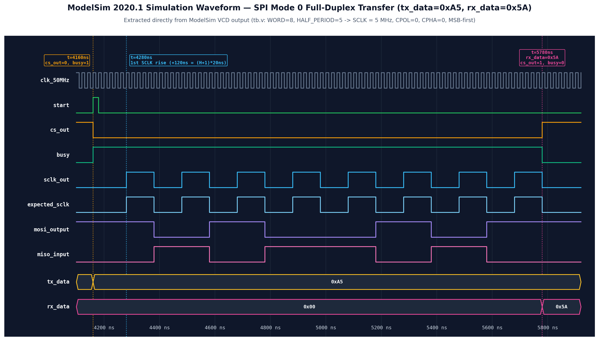

# Parameterizable SPI Master Controller (`t2a_spi`)

A clean, parameterizable **Serial Peripheral Interface (SPI) Master** IP core written in synthesizable Verilog HDL (`t2a_spi`), originally developed for **eYRC26-27: Logic Quest (Task 2A)** and verified in RTL simulation using ModelSim.



---

## Table of Contents

- [Project Overview](#project-overview)
- [Motivation and Objectives](#motivation-and-objectives)
- [Key Features (Implemented in RTL)](#key-features-implemented-in-rtl)
- [SPI Protocol Overview](#spi-protocol-overview)
- [CPOL, CPHA & Supported SPI Modes](#cpol-cpha--supported-spi-modes)
- [Architecture & Module Description](#architecture--module-description)
- [Data Transmission & Reception Flow](#data-transmission--reception-flow)
- [Configurable Parameters & Port Interface](#configurable-parameters--port-interface)
- [FPGA Implementation Status](#fpga-implementation-status)
- [Simulation & Verification Methodology](#simulation--verification-methodology)
- [How to Run Simulation](#how-to-run-simulation)
- [How to Open in Intel Quartus Prime](#how-to-open-in-intel-quartus-prime)
- [Repository Directory Structure](#repository-directory-structure)
- [Limitations & Future Improvements](#limitations--future-improvements)
- [License](#license)

---

## Project Overview

`t2a_spi` is a synchronous, single-module Verilog SPI Master controller designed around a 50 MHz input clock (`clk_50MHz`) and active-low asynchronous reset (`rst_n`). On a `start` pulse in the `IDLE` state, the controller asserts active-low chip select (`cs_out`), drives `busy` high, generates a divided serial clock (`sclk_out`), and performs full-duplex serial data transfer over `mosi_output` and `miso_input` before latching the received word onto `rx_data`.

---

## Motivation and Objectives

- Implement a **clean, self-contained, synthesizable Verilog SPI Master** without external IP dependencies.
- Parameterize **word length**, **serial clock frequency divider**, **bit ordering**, and **idle clock polarity** via Verilog `parameter` and `$clog2` bit-width derivation.
- Achieve **cycle-accurate SCLK generation** and **full-duplex TX/RX shifting** synchronized to a 50 MHz system clock domain.
- Verify Mode 0 (`CPOL=0, CPHA=0`), 8-bit MSB-first full-duplex communication against a behavioral SPI slave model in simulation.

---

## Key Features (Implemented in RTL)

Based strictly on [`rtl/t2a_spi.v`](rtl/t2a_spi.v):

- **Full-Duplex Serial Transfer**: Simultaneously shifts `tx_data` out on `mosi_output` and shifts `miso_input` into `rx_shift`, latching the completed word into `rx_data` at transfer completion.
- **Configurable Clock Divider (`HALF_PERIOD`)**: Derives `sclk_out` from `clk_50MHz` with 50% steady-state duty cycle ($f_{\text{SCLK}} = \frac{50\text{ MHz}}{2 \times \text{HALF\_PERIOD}}$; default `HALF_PERIOD = 25` $\rightarrow$ `1 MHz`).
- **Configurable Clock Polarity (`CPOL`)**: Sets `sclk_out` reset/idle level (`0` or `1`) and selects the leading-edge polarity (`sclk_out == CPOL`).
- **Configurable Bit Order (`LSB_FIRST`)**: Supports MSB-first (`LSB_FIRST = 0`, default) and LSB-first (`LSB_FIRST = 1`) shift direction in RTL.
- **Configurable Word Length (`SPI_WORD_LENGTH`)**: Parameterized parallel data width and `bit_count` sizing via `$clog2` (default `8` bits).
- **Deterministic Handshake & Framing**: Dedicated `start`, `busy`, and active-low `cs_out` signals with active-low asynchronous reset (`rst_n`).

---

## SPI Protocol Overview

SPI is a synchronous four-wire serial bus connecting one master to one or more peripherals:

| Signal | Master Direction | Purpose |
|---|---|---|
| `sclk_out` | Output | Serial clock driven by master during active transfers; idles at `CPOL` |
| `cs_out` | Output | Active-low chip select framing each word transfer |
| `mosi_output` | Output | Master-Out, Slave-In serial data line |
| `miso_input` | Input | Master-In, Slave-Out serial data line |

For a deeper protocol explanation and edge diagrams, see [`docs/spi_protocol.md`](docs/spi_protocol.md).

---

## CPOL, CPHA & Supported SPI Modes

In [`rtl/t2a_spi.v`](rtl/t2a_spi.v), `CPOL` and `CPHA` are declared in the module parameter list (`lines 34–35`):

- **`CPOL` is actively used in RTL**: It defines the reset/idle state of `sclk_out` and selects the leading edge (`sclk_out == CPOL` prior to toggling `sclk_out <= ~sclk_out`).
- **`CPHA` is declared in the module header but not referenced in the RTL body**: The state machine implements **`CPHA = 0` timing only** (pre-drives the first `mosi_output` bit when `start` is sampled, samples `miso_input` on the leading edge, and shifts `mosi_output` on the trailing edge).

| SPI Mode | `CPOL` | `CPHA` | Idle `SCLK` | Sample Edge (Theory) | Shift Edge (Theory) | RTL Implementation Status | Testbench Verification Status |
|---|---|---|---|---|---|---|---|
| **Mode 0** | `0` | `0` | Low (`0`) | Rising (leading) | Falling (trailing) | **Implemented** | **Verified** in [`testbench/tb.v`](testbench/tb.v) |
| **Mode 1** | `0` | `1` | Low (`0`) | Falling (trailing) | Rising (leading) | **Not implemented** (`CPHA` unused) | Not tested |
| **Mode 2** | `1` | `0` | High (`1`) | Falling (leading) | Rising (trailing) | **Supported by `CPOL=1` RTL** | Not tested (`tb.v` sets `CPOL=0`) |
| **Mode 3** | `1` | `1` | High (`1`) | Rising (trailing) | Falling (leading) | **Not implemented** (`CPHA` unused) | Not tested |



---

## Architecture & Module Description

The design consists of a single top-level RTL module, `t2a_spi`, containing a 2-state FSM (`IDLE` and `TRANSFER`) and five tightly coupled functional blocks:

1. **Control FSM (`state`, `first_half`)**: Manages `IDLE` $\leftrightarrow$ `TRANSFER` transitions, captures `start`, controls `cs_out`/`busy`, and tracks the initial `HALF_PERIOD + 1` setup window via `first_half`.
2. **Clock Divider & SCLK Generator (`cycle_count`, `sclk_out`)**: Generates divided `sclk_out` edges from `clk_50MHz`.
3. **TX Shift Register & MOSI Mux (`tx_shift`, `mosi_output`)**: Captures `tx_data` on `start`, outputs the initial bit immediately, and shifts out subsequent bits on trailing edges.
4. **Bit Counter (`bit_count`)**: Counts transmitted bits from `0` to `SPI_WORD_LENGTH - 1` on trailing edges.
5. **RX Shift Register & Output Latch (`rx_shift`, `rx_data`)**: Samples `miso_input` on leading edges and latches the completed word into `rx_data` when returning to `IDLE`.

See [`docs/architecture.md`](docs/architecture.md) for full state-transition equations, register widths, and cycle counts.

---

## Data Transmission & Reception Flow



1. **Reset / `IDLE`**: `sclk_out = CPOL`, `cs_out = 1`, `busy = 0`, and internal counters are cleared.
2. **Start (`IDLE` $\rightarrow$ `TRANSFER`)**: When `start == 1` on a rising edge of `clk_50MHz`:
   - `tx_shift <= tx_data` and `rx_shift <= 0`.
   - `cs_out <= 0` and `busy <= 1`.
   - First bit (`tx_data[0]` if `LSB_FIRST`, else `tx_data[SPI_WORD_LENGTH-1]`) is immediately driven onto `mosi_output`.
   - `first_half <= 1` and `state <= TRANSFER`.
3. **First Half-Period (`first_half == 1`)**:
   - `cycle_count` counts `0` to `HALF_PERIOD` (`HALF_PERIOD + 1` system clock cycles to align registered `sclk_out`).
   - `sclk_out` toggles (`CPOL` $\rightarrow$ `~CPOL`, leading edge) and `miso_input` is sampled into `rx_shift`; `first_half` clears to `0`.
4. **Active Bit Loop (`first_half == 0`)**:
   - Every `HALF_PERIOD` clock cycles (`cycle_count == HALF_PERIOD - 1`), `sclk_out` toggles:
     - **Leading edge (`sclk_out == CPOL` before toggle)**: `miso_input` is shifted into `rx_shift`.
     - **Trailing edge (`sclk_out != CPOL` before toggle)**: If `bit_count < SPI_WORD_LENGTH - 1`, `bit_count` increments and `tx_shift` advances `mosi_output` to the next bit.
5. **Completion (`bit_count == SPI_WORD_LENGTH - 1` on trailing edge)**:
   - `sclk_out <= CPOL`, `cs_out <= 1`, `busy <= 0`, `rx_data <= rx_shift`, counters reset, and `state <= IDLE`.

---

## Configurable Parameters & Port Interface

### Parameters

| Parameter | Default | Description |
|---|---|---|
| `CPOL` | `1'b0` | Clock polarity: `0` = SCLK idles low, `1` = SCLK idles high |
| `CPHA` | `1'b0` | Clock phase parameter in header (unused in current RTL; `CPHA=0` behavior is implemented) |
| `LSB_FIRST` | `1'b0` | Bit transmission/reception order: `0` = MSB-first, `1` = LSB-first |
| `SPI_WORD_LENGTH` | `8` | Number of bits per SPI frame |
| `HALF_PERIOD` | `25` | Number of `clk_50MHz` cycles per SCLK half-period (`>= 1`); SCLK = $50\text{ MHz} / (2 \times \text{HALF\_PERIOD})$ |

### Instantiation Template

```verilog
t2a_spi #(
    .CPOL            (1'b0),
    .CPHA            (1'b0), // Note: current RTL executes CPHA=0 timing only
    .LSB_FIRST       (1'b0),
    .SPI_WORD_LENGTH (8),
    .HALF_PERIOD     (25)    // 1 MHz SCLK from 50 MHz clk_50MHz
) u_spi_master (
    .clk_50MHz   (clk_50MHz),
    .rst_n       (rst_n),
    .start       (start),
    .tx_data     (tx_data),
    .miso_input  (miso_input),
    .sclk_out    (sclk_out),
    .cs_out      (cs_out),
    .mosi_output (mosi_output),
    .rx_data     (rx_data),
    .busy        (busy)
);
```

### Ports

| Port | Direction | Width | Description |
|---|---|---|---|
| `clk_50MHz` | `input` | `1` | System clock (50 MHz) |
| `rst_n` | `input` | `1` | Active-low asynchronous reset |
| `start` | `input` | `1` | Start strobe sampled in `IDLE` |
| `tx_data` | `input` | `SPI_WORD_LENGTH` | Parallel data word to transmit |
| `miso_input` | `input` | `1` | Serial input from SPI slave |
| `sclk_out` | `output reg` | `1` | SPI serial clock |
| `cs_out` | `output reg` | `1` | Active-low chip select |
| `mosi_output` | `output reg` | `1` | Serial output to SPI slave |
| `rx_data` | `output reg` | `SPI_WORD_LENGTH` | Received parallel data word (updated at transfer end) |
| `busy` | `output reg` | `1` | Transfer-in-progress indicator |

---

## FPGA Implementation Status

- **Quartus Project / Constraint Files**: No Intel Quartus project files (`.qpf`, `.qsf`), Timing Analyzer constraints (`.sdc`), pin assignments, compilation reports, or target FPGA board specifications are present in the original project source folder.
- **Hardware Testing**: No FPGA hardware programming or hardware-in-the-loop verification evidence is present in this repository. All verification reported here is from **RTL behavioral simulation**.

---

## Simulation & Verification Methodology

Verification was performed using the existing testbench [`testbench/tb.v`](testbench/tb.v) in **ModelSim - Intel FPGA Edition 2020.1**:

- **Testbench Configuration**: `CPOL = 0`, `CPHA = 0`, `LSB_FIRST = 0`, `SPI_WORD_LENGTH = 8`, `HALF_PERIOD = 5` (`5 MHz` SCLK at `50 MHz` `clk_50MHz`, `CLK_PERIOD = 20 ns`).
- **Modeled SPI Slave**: Samples `mosi_output` on `posedge sclk_out` into `mosi_shadow_reg`, drives `miso_input` MSB-first on `negedge cs_out` and `negedge sclk_out`, and checks `sclk_out` against a golden `expected_sclk` waveform as well as `cs_out === ~busy`.
- **Observed Simulation Results (`0` to `15 us`)**:
  - Compilation of `rtl/t2a_spi.v` and `testbench/tb.v`: **0 errors, 0 warnings**.
  - `cs_out === ~busy` and `sclk_out === expected_sclk` passed continuously across all clock cycles with **0 mismatches**.
  - Full-duplex transactions observed in ModelSim VCD output:

| Vector (`tx_data` / `expected_rx_data`) | Start Time | End Time | Observed `mosi_shadow_reg` | Observed `rx_data` | Status |
|---|---|---|---|---|---|
| `0x00` / `0xFF` | `120 ns` | — | — | — | Not triggered by `tb.v` stimulus race (see note below) |
| `0xFF` / `0x00` | `2140 ns` | `3760 ns` | `0xFF` | `0x00` | Pass |
| `0xA5` / `0x5A` | `4160 ns` | `5780 ns` | `0xA5` | `0x5A` | Pass |
| `0x5A` / `0xA5` | `6180 ns` | `7800 ns` | `0x5A` | `0xA5` | Pass |
| `0x81` / `0x3C` | `8200 ns` | `9820 ns` | `0x81` | `0x3C` | Pass |
| `0x3C` / `0x81` | `10220 ns` | `11840 ns` | `0x3C` | `0x81` | Pass |



> **Important Testbench Observations (`tb.v`)**:
> 1. `tb.v` is preserved unmodified from the original source (`// No Teams are allowed to edit this file.`).
> 2. Its `always @(clk_50MHz)` data-checking block (`lines 121–149`) runs every 10 ns, prints `"No errors encountered, congratulations!"` at `51 ns` during reset, and suspends for `#50000` (`50 us`). If simulation continues past `50 us`, that block wakes up mid-transfer and flags transient mismatches (`error_count = 12` at `55 us`).
> 3. The first vector in each loop (`0x00/0xFF`) fails to latch `start` into `t2a_spi` due to blocking stimulus timing in `tb.v` (`line 71`), whereas vectors 2–6 execute complete `1620 ns` transfers accurately.

---

## How to Run Simulation

### Option 1: ModelSim / QuestaSim (Included Script)

A ready-to-run TCL macro is provided at [`simulation/run_sim.do`](simulation/run_sim.do).

**GUI mode (with waveform viewer):**
1. Open ModelSim / QuestaSim.
2. Change directory to `simulation/`.
3. Run:
   ```tcl
   do run_sim.do
   ```

**Batch / CLI mode (PowerShell from the `simulation/` directory):**
```powershell
vsim -c -do "do run_sim.do; quit -f"
```

### Option 2: Manual Compilation (ModelSim CLI)

From the repository root:
```powershell
vlib work
vlog rtl/t2a_spi.v testbench/tb.v
vsim -c work.tb -do "run 15us; quit -f"
```

---

## How to Open in Intel Quartus Prime

Because no pre-existing Quartus project files (`.qpf`/`.qsf`) were included in the source folder, follow these steps to synthesize `t2a_spi` in Intel Quartus Prime:

1. Open **Intel Quartus Prime** and select **File $\rightarrow$ New Project Wizard**.
2. Choose a working project directory (outside `rtl/`, or keep build outputs ignored by `.gitignore`) and set the **Top-Level Entity** name to `t2a_spi`.
3. Add [`rtl/t2a_spi.v`](rtl/t2a_spi.v) as the design source file.
4. Select your target Intel FPGA device family and part number.
5. Add an `.sdc` timing constraint file defining your `50 MHz` clock on `clk_50MHz` (e.g., `create_clock -name clk_50MHz -period 20.000 [get_ports clk_50MHz]`) and assign FPGA pins via **Pin Planner**.
6. Run **Analysis & Synthesis** (or full **Compile Design**) to inspect resource utilization and timing reports.

---

## Repository Directory Structure

```text
spi/
├── README.md
├── LICENSE
├── .gitignore
├── rtl/
│   └── t2a_spi.v                         # Parameterizable SPI Master RTL module
├── testbench/
│   └── tb.v                              # Original SPI Mode 0 verification testbench
├── simulation/
│   └── run_sim.do                        # ModelSim/QuestaSim compilation & run script
├── docs/
│   ├── architecture.md                   # Detailed RTL architecture, FSM, and timing
│   └── spi_protocol.md                   # SPI protocol theory vs. RTL/TB coverage
└── images/
    ├── architecture/
    │   ├── spi_master_block_diagram.png  # t2a_spi internal block diagram
    │   ├── spi_fsm_and_timing.png        # 2-state FSM and cycle-accurate timing diagram
    │   └── spi_modes_cpol_cpha.png       # 4 SPI modes comparison & implementation status
    └── simulation/
        └── spi_mode0_waveform.png        # ModelSim VCD waveform (0xA5 TX / 0x5A RX)
```

---

## Limitations & Future Improvements

### Current Limitations
- **`CPHA = 1` (SPI Modes 1 & 3) not implemented**: `CPHA` is declared as a module parameter but is unused in the RTL logic; only `CPHA = 0` edge timing is executed.
- **Limited testbench coverage**: [`testbench/tb.v`](testbench/tb.v) only verifies `CPOL = 0`, `CPHA = 0`, `LSB_FIRST = 0`, `SPI_WORD_LENGTH = 8`, `HALF_PERIOD = 5`, and has a `always @(clk_50MHz)` timing bug past `50 us`.
- **Single-CS, single-word framing**: Controls one `cs_out` line and deasserts `cs_out` after each `SPI_WORD_LENGTH` transfer; no multi-byte burst mode or multi-slave CS decode.
- **No `HALF_PERIOD == 0` guard**: Setting `HALF_PERIOD = 0` would underflow `HALF_PERIOD - 1`.
- **No Quartus synthesis/hardware artifacts**: No `.qpf`/`.qsf`/`.sdc` constraints or FPGA board validation are included yet.

### Planned / Recommended Future Improvements
1. **Implement full `CPHA = 1` support** in `t2a_spi.v` so all four SPI modes (0, 1, 2, 3) operate as documented.
2. **Add an expanded self-checking verification suite** (separate from the original `tb.v`) covering Modes 0/1/2/3, `LSB_FIRST = 1`, non-8-bit `SPI_WORD_LENGTH` (e.g., 16-bit), back-to-back transfers, and mid-transfer reset.
3. **Add multi-slave `cs_out` and continuous burst support** (e.g., `NUM_SLAVES` parameter and `keep_cs` control).
4. **Create a Quartus Prime reference project** targeting an FPGA development board with `.sdc` timing constraints, SignalTap/hardware loopback tests, and resource/Fmax benchmarks.

---

## License

This project is licensed under the **MIT License** — see [`LICENSE`](LICENSE) for details.
