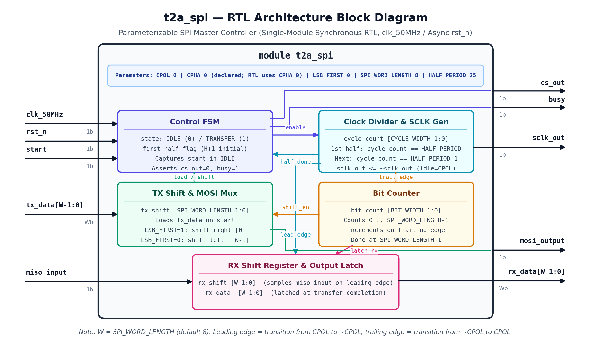
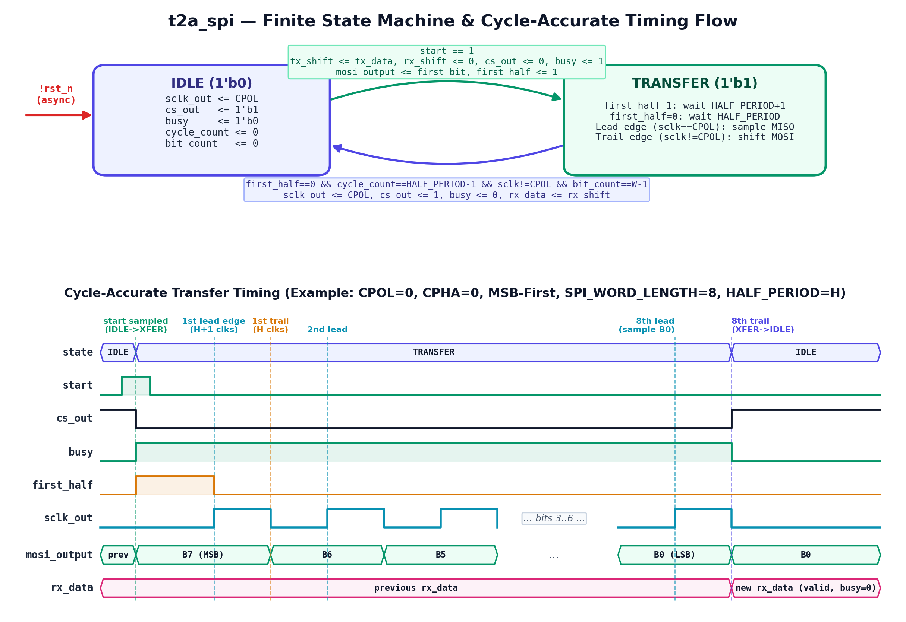

# SPI Master Architecture (`t2a_spi`)

This document describes the internal RTL architecture, state machine, registers, clock division timing, and verification details of [`t2a_spi`](../rtl/t2a_spi.v).

## 1. Module Hierarchy & Interface

`t2a_spi` is implemented as a **single self-contained Verilog module** (`rtl/t2a_spi.v`) with no external submodules. All sequential state updates occur inside a single `always @(posedge clk_50MHz or negedge rst_n)` block using non-blocking assignments.

### Parameters

| Parameter | Default | Derived Width / Usage | Implementation Status |
|---|---|---|---|
| `CPOL` | `1'b0` | Sets idle/reset level of `sclk_out` (`0` = idle low, `1` = idle high) and leading-edge check (`sclk_out == CPOL`) | Implemented |
| `CPHA` | `1'b0` | Declared in module parameter list (line 35) | **Declared only (unused in RTL body)**; FSM implements `CPHA = 0` edge behavior |
| `LSB_FIRST` | `1'b0` | Selects shift direction (`0` = MSB first, `1` = LSB first) | Implemented |
| `SPI_WORD_LENGTH` | `8` | Width of `tx_data`, `rx_data`, `tx_shift`, `rx_shift`; `BIT_WIDTH = (SPI_WORD_LENGTH <= 1) ? 1 : $clog2(SPI_WORD_LENGTH)` | Implemented |
| `HALF_PERIOD` | `25` | `clk_50MHz` cycles per SCLK half-period; `CYCLE_WIDTH = (HALF_PERIOD <= 1) ? 1 : $clog2(HALF_PERIOD + 1)` | Implemented (requires `HALF_PERIOD >= 1`) |

### Ports

| Port | Direction | Width | Reset Value | Description |
|---|---|---|---|---|
| `clk_50MHz` | Input | 1 | — | System clock (nominal 50 MHz) |
| `rst_n` | Input | 1 | — | Active-low asynchronous reset |
| `start` | Input | 1 | — | Synchronous start trigger sampled when `state == IDLE` |
| `tx_data` | Input | `SPI_WORD_LENGTH` | — | Parallel transmit word captured when `start == 1` in `IDLE` |
| `miso_input` | Input | 1 | — | Serial data input sampled on leading SCLK edges |
| `sclk_out` | Output (`reg`) | 1 | `CPOL` | Divided SPI serial clock |
| `cs_out` | Output (`reg`) | 1 | `1'b1` | Active-low chip select; `0` throughout `TRANSFER` |
| `mosi_output` | Output (`reg`) | 1 | `1'b0` | Serial data output; pre-loaded on `start`, shifted on trailing edges |
| `rx_data` | Output (`reg`) | `SPI_WORD_LENGTH` | `0` | Parallel received word latched from `rx_shift` at transfer end |
| `busy` | Output (`reg`) | 1 | `1'b0` | High while `state == TRANSFER`; `0` in `IDLE` |

---

## 2. Internal Registers & Functional Blocks

1. **Control FSM (`state`, `first_half`)**:
   - `state` is a 1-bit register encoding `IDLE` (`1'b0`) and `TRANSFER` (`1'b1`).
   - `first_half` is a 1-bit register set to `1'b1` when transitioning from `IDLE` to `TRANSFER`, distinguishing the initial SCLK setup half-period from subsequent steady-state half-periods.
2. **Clock Divider (`cycle_count`)**:
   - Width: `CYCLE_WIDTH` bits (`$clog2(HALF_PERIOD + 1)` for `HALF_PERIOD > 1`).
   - Divides `clk_50MHz` to produce `sclk_out` at $f_{\text{SCLK}} = \frac{f_{\text{clk}}}{2 \times \text{HALF\_PERIOD}}$.
   - With default `HALF_PERIOD = 25` at 50 MHz, $f_{\text{SCLK}} = 1\text{ MHz}$. In the testbench override (`HALF_PERIOD = 5`), $f_{\text{SCLK}} = 5\text{ MHz}$.
3. **Bit Counter (`bit_count`)**:
   - Width: `BIT_WIDTH` bits (`$clog2(SPI_WORD_LENGTH)` for `SPI_WORD_LENGTH > 1`).
   - Counts from `0` to `SPI_WORD_LENGTH - 1`, incrementing on each trailing SCLK edge before the final bit.
4. **TX Shift Register & MOSI Mux (`tx_shift`, `mosi_output`)**:
   - Loads `tx_data` on `start == 1` in `IDLE` and immediately drives the first output bit (`tx_data[0]` if `LSB_FIRST == 1`, else `tx_data[SPI_WORD_LENGTH-1]`) onto `mosi_output`.
   - Shifts on every trailing edge except the last bit, updating `mosi_output` with the next bit (`tx_shift[1]` if `LSB_FIRST == 1`, else `tx_shift[SPI_WORD_LENGTH-2]`).
5. **RX Shift Register & Output Latch (`rx_shift`, `rx_data`)**:
   - Cleared to zero on `start == 1` in `IDLE`.
   - Samples `miso_input` on every leading SCLK edge (`sclk_out == CPOL` before toggle):
     - `LSB_FIRST == 1`: `{miso_input, rx_shift[SPI_WORD_LENGTH-1:1]}`
     - `LSB_FIRST == 0`: `{rx_shift[SPI_WORD_LENGTH-2:0], miso_input}`
   - Latches `rx_data <= rx_shift` on the final trailing edge when `bit_count == SPI_WORD_LENGTH - 1`.

---

## 3. Finite State Machine & Cycle-Accurate Timing

### State Transitions

1. **Asynchronous Reset (`!rst_n`)**:
   - Forces `state <= IDLE`, `sclk_out <= CPOL`, `cs_out <= 1'b1`, `mosi_output <= 1'b0`, `rx_data <= 0`, `busy <= 1'b0`, `cycle_count <= 0`, `bit_count <= 0`, `tx_shift <= 0`, `rx_shift <= 0`, and `first_half <= 1'b0`.
2. **`IDLE` State**:
   - Holds `sclk_out <= CPOL`, `cs_out <= 1'b1`, `busy <= 1'b0`, and keeps counters cleared.
   - Note: `mosi_output` and `rx_data` retain their previous values while in `IDLE` until the next transfer starts or finishes.
   - When `start == 1'b1`:
     - Captures `tx_shift <= tx_data` and clears `rx_shift <= 0`.
     - Asserts `cs_out <= 1'b0` and `busy <= 1'b1`.
     - Drives the initial bit on `mosi_output`.
     - Sets `first_half <= 1'b1` and enters `state <= TRANSFER`.
3. **`TRANSFER` State — Initial Half-Period (`first_half == 1'b1`)**:
   - Waits until `cycle_count == HALF_PERIOD` (an elapsed interval of `HALF_PERIOD + 1` `clk_50MHz` cycles from `cs_out` falling, accounting for registered `sclk_out` latency—verified in `tb.v` via `#((HALF + 1) * CLK_PERIOD)`).
   - Clears `cycle_count <= 0` and `first_half <= 1'b0`.
   - Toggles `sclk_out <= ~sclk_out` (leading edge: `CPOL` $\rightarrow$ `~CPOL`).
   - Because `sclk_out == CPOL` prior to the non-blocking update, samples `miso_input` into `rx_shift`.
4. **`TRANSFER` State — Subsequent Half-Periods (`first_half == 1'b0`)**:
   - Counts `cycle_count` from `0` to `HALF_PERIOD - 1` (`HALF_PERIOD` clock cycles per half-period, giving a 50% duty cycle).
   - Toggles `sclk_out <= ~sclk_out`:
     - **Leading edge (`sclk_out == CPOL` before toggle)**: Samples `miso_input` into `rx_shift`.
     - **Trailing edge (`sclk_out != CPOL` before toggle)**:
       - If `bit_count == SPI_WORD_LENGTH - 1`: returns `sclk_out <= CPOL`, deasserts `cs_out <= 1'b1` and `busy <= 1'b0`, latches `rx_data <= rx_shift`, resets counters, and returns to `IDLE`.
       - Else: increments `bit_count`, shifts `tx_shift`, and drives the next bit onto `mosi_output`.

### Total Transfer Duration

For `SPI_WORD_LENGTH = W` and `HALF_PERIOD = H`:

$$\text{Total } \texttt{clk\_50MHz} \text{ cycles in TRANSFER} = (H + 1) + (2W - 1) \cdot H = 2WH + 1$$

For the testbench configuration ($W = 8$, $H = 5$, $T_{\text{clk}} = 20\text{ ns}$):

$$(2 \times 8 \times 5 + 1) \times 20\text{ ns} = 81 \times 20\text{ ns} = 1620\text{ ns}$$

This matches the observed ModelSim VCD transfer duration (`4160 ns` to `5780 ns` = `1620 ns`).

---

## 4. Implementation Notes & Edge Cases

- **`HALF_PERIOD` minimum**: Because `TRANSFER` compares `cycle_count == HALF_PERIOD - 1` when `first_half == 0`, `HALF_PERIOD` must be $\ge 1$.
- **Unreferenced `CPHA` parameter**: `CPHA` is exposed in the module header (`rtl/t2a_spi.v` line 35) for interface compatibility, but it is not evaluated in the RTL state machine. Overriding `CPHA = 1'b1` does not change the synthesized hardware behavior.
- **`start` pulse handling**: `start` is only sampled in `IDLE`. Pulsing `start` while `busy == 1` has no effect; holding `start` high across transfer completion will immediately initiate another transfer on the clock edge following `IDLE` entry.
