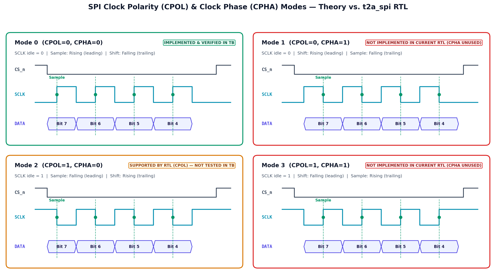

# SPI Protocol & Implementation Mapping

This document explains standard Serial Peripheral Interface (SPI) communication principles and explicitly maps what is **implemented in RTL** and **verified in simulation** in [`t2a_spi`](../rtl/t2a_spi.v).

## 1. SPI Protocol Fundamentals

SPI is a synchronous, full-duplex, serial peripheral bus using four standard signals:

| Signal | Direction (Master View) | Role |
|---|---|---|
| `SCLK` (`sclk_out`) | Output | Serial clock generated by the master only during active transfers |
| `CS_n` (`cs_out`) | Output | Active-low chip select framing a transaction |
| `MOSI` (`mosi_output`) | Output | Master Out, Slave In serial data line |
| `MISO` (`miso_input`) | Input | Master In, Slave Out serial data line |

Because `MOSI` and `MISO` operate on separate unidirectional lines clocked by the same `SCLK`, one bit is transmitted and one bit is received simultaneously on every `SCLK` cycle (full-duplex transfer).

---

## 2. Clock Polarity (`CPOL`) and Clock Phase (`CPHA`)

In general SPI theory, two configuration bits define four operating modes:

- **`CPOL` (Clock Polarity)**: Defines the idle logic level of `SCLK` when `CS_n` is high:
  - `CPOL = 0`: `SCLK` idles low (`0`). Leading edge is rising (`0 -> 1`); trailing edge is falling (`1 -> 0`).
  - `CPOL = 1`: `SCLK` idles high (`1`). Leading edge is falling (`1 -> 0`); trailing edge is rising (`0 -> 1`).
- **`CPHA` (Clock Phase)**: Defines which `SCLK` edge samples data versus shifts data:
  - `CPHA = 0`: First data bit is placed on `MOSI`/`MISO` when `CS_n` goes low (before the first `SCLK` edge). Data is **sampled on the leading edge** and **shifted on the trailing edge**.
  - `CPHA = 1`: First data bit is driven on the leading `SCLK` edge. Data is **shifted on the leading edge** and **sampled on the trailing edge**.

---

## 3. Standard SPI Modes vs. `t2a_spi` Status

> **Important Distinction**: The module header comment in `rtl/t2a_spi.v` describes all four SPI modes (`CPOL`/`CPHA`). However, inspecting lines 58–333 of [`t2a_spi.v`](../rtl/t2a_spi.v#L58-L333) shows that **`CPOL` is implemented**, whereas **`CPHA` is declared as a parameter (`line 35`) but never referenced in the RTL logic**. The state machine implements `CPHA = 0` edge timing exclusively.

| Mode | `CPOL` | `CPHA` | Standard Idle Level | Standard Sample Edge | Standard Shift Edge | `t2a_spi` RTL Status | `tb.v` Verification Status |
|---|---|---|---|---|---|---|---|
| **Mode 0** | `0` | `0` | Low (`0`) | Rising (leading) | Falling (trailing) | **Implemented** | **Verified** (`tx_data`/`rx_data` full-duplex, `cs_out`, `busy`, `sclk_out`) |
| **Mode 1** | `0` | `1` | Low (`0`) | Falling (trailing) | Rising (leading) | **Not implemented** (`CPHA` unused) | Not tested |
| **Mode 2** | `1` | `0` | High (`1`) | Falling (leading) | Rising (trailing) | **Implemented via `CPOL=1` logic** (`sclk_out <= CPOL`, leading check `sclk_out == CPOL`) | **Not tested** (`tb.v` hardcodes `CPOL=0`) |
| **Mode 3** | `1` | `1` | High (`1`) | Rising (trailing) | Falling (leading) | **Not implemented** (`CPHA` unused) | Not tested |

---

## 4. Bit Order & Word Length

### Bit Order (`LSB_FIRST`)
- **`LSB_FIRST = 0` (Default, MSB-first)**:
  - `mosi_output` starts with `tx_data[SPI_WORD_LENGTH-1]` and shifts left (`tx_shift[SPI_WORD_LENGTH-2:0], 1'b0`).
  - `rx_shift` shifts left (`rx_shift[SPI_WORD_LENGTH-2:0], miso_input`).
  - **Verified** in [`tb.v`](../testbench/tb.v).
- **`LSB_FIRST = 1` (LSB-first)**:
  - `mosi_output` starts with `tx_data[0]` and shifts right (`1'b0, tx_shift[SPI_WORD_LENGTH-1:1]`).
  - `rx_shift` shifts right (`miso_input, rx_shift[SPI_WORD_LENGTH-1:1]`).
  - **Implemented in RTL**, not exercised by [`tb.v`](../testbench/tb.v).

### Word Length (`SPI_WORD_LENGTH`)
- Default is `8` bits; parameterized across `tx_data`, `rx_data`, `tx_shift`, `rx_shift`, and `bit_count`.
- `tb.v` exercises `SPI_WORD_LENGTH = 8`. Other word widths (e.g., 16-bit) are supported by the RTL parameterization but not exercised by the provided testbench.
